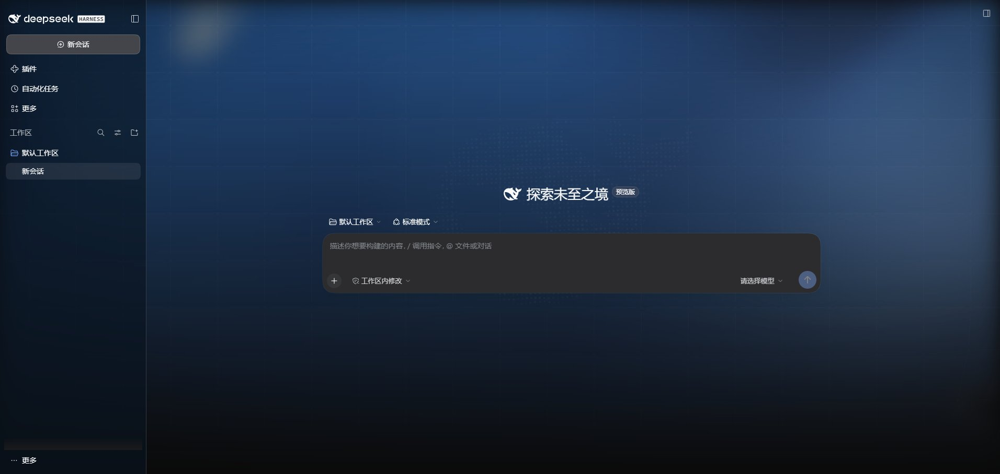
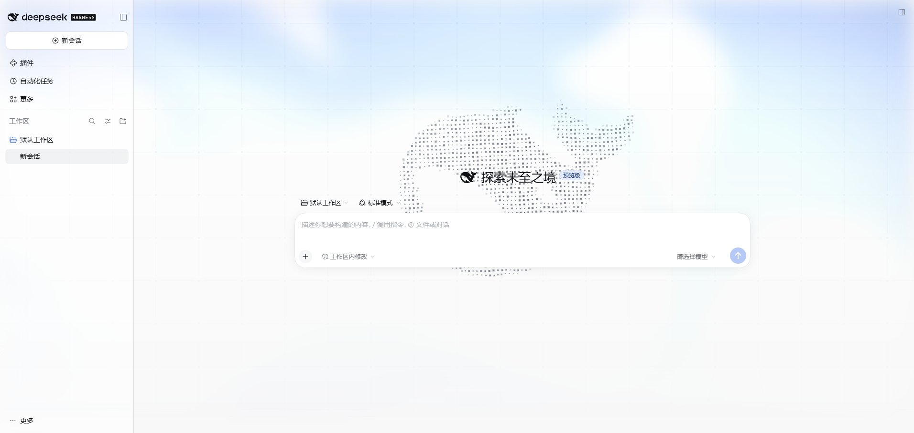

# dsh-dshomepage-skin

A **DeepSeek Harness (DSH) skin plugin** providing the homepage background — WebGL fluid light, dot grid and a digital point-cloud whale — for the **DSH 0.2.x desktop app** and `dsh web`. Dark and light palettes included.

This repository is a DSH 0.2.2-rc.1 port of [yushi-xxh/dsh-homepage-skin](https://github.com/yushi-xxh/dsh-homepage-skin) (MIT). The visuals stay the same; the shell selectors, version declarations and desktop-only layers were rewritten so the skin actually renders in the current desktop build.

| Dark | Light |
| --- | --- |
|  |  |

## Compatibility

| Item | Value |
| --- | --- |
| Target runtime | DSH `>=0.2.2-rc.1 <0.3.0` (`engines.dsh`) |
| Tested against | DSH 0.2.2-rc.1 (desktop shell 44.7.0, Windows x64) |
| Other host | `dsh web` 0.2.x |
| Dependencies | None — the bundle requires no client modules and uses no slots/locale/store |

Changes since upstream 0.1.13:

- Shell selectors no longer hard-code the 0.1 CSS Module hashes (`.pI_x6G_*`). 0.2.x is addressed through the stable `data-slot` contract — `[data-slot="root"] > div` (AppFrame), `[data-slot="sidebar"]`, `[data-slot="main.conversation"]` — with the old class names kept only as selector fallbacks; the declared support range remains DSH `>=0.2.2-rc.1 <0.3.0`.
- Covers the opaque layers the 0.2.x desktop shell adds: the frame / center column fill under the Windows title bar and the title-bar drag strip (`:before`).
- Declares `engines.dsh` (`>=0.2.2-rc.1 <0.3.0`) so the 0.2.2 boot compatibility check admits the bundle; no peer dependencies are needed.
- Plugin name and gate attribute are `dsh-dshomepage-skin` / `data-dsh-dshomepage-skin`, so it can coexist with the upstream plugin.

## Install

Desktop (recommended) — install straight from GitHub, then restart the desktop app:

```sh
dsh plugin --profile desktop add github:SiriusWJ/dsh-dshomepage-skin
```

You can also add that GitHub spec from the Plugins page. `dshmarket` synchronizes entries from awesome-dsh-plugin; current submission rules require a repository age of at least one day.

`dsh web`:

```sh
dsh plugin --profile web add github:SiriusWJ/dsh-dshomepage-skin
```

## Usage

Takes effect as soon as the app starts — there is no settings switch. Uninstalling or disabling the plugin removes every canvas and style immediately.

- Dark / light palette follows the built-in appearance (`body[data-ds-dark-theme]`).
- `prefers-reduced-motion: reduce` keeps a static frame without animation.
- Below 768px the whale and grid stay hidden to avoid covering content.

### Verification (2026-11-11, DSH 0.2.2-rc.1)

- Installed from a local path into a throwaway profile and restarted: the page mounts `data-dsh-dshomepage-skin`, three canvases, and `[data-slot="root"] > div` computes to a transparent background.
- This build has no settings row: the skin is always on while the bundle is loaded, and teardown on uninstall removes every canvas and style.
- `npm test` (zero-dependency smoke test) checks the bundle id, that nothing is `require`d, the empty `inject` list, the gated style injection and teardown cleanup.
- Both palettes follow `body[data-ds-dark-theme]`; screenshots in `docs/` were captured from a fresh `dsh web` environment with an isolated data home (1912×908), showing only the default workspace and an empty session, without a signed-in account.
- Version 0.1.11 was screenshot-verified in the Windows desktop Plugins page: the native sidebar toggle remains left of the Application menu, separate from the whale logo, and can collapse and reopen the sidebar. The sidebar ancestor no longer has `backdrop-filter`, and the extra floating escape handle was removed.

## Plugin display metadata

The Plugin Manager and Settings read display metadata without activating the plugin:

- `meta.title` / `meta.description` in `locale/en.json` and `locale/zh.json` (falling back to the package name and the `package.json` description)
- `icon` in `package.json` (or an `./icon` export) — SVG/PNG/JPEG/WebP, ≤256 KiB
- Supported DSH versions live in `engines.dsh` (`>=0.2.2-rc.1 <0.3.0`); the description also states 0.2.2-rc.1+, and the detail page shows the README
- `icon.png` is the 256×256 storefront tile exported from the same licensed SVG; `screenshots.json` declares the dark/light screenshots
- GitHub topics and package keywords include `dsh-plugin`; the manifest declares `dsh.bundle.patch` and `dsh.client` for installation through DSH

The installed list shows the icon, title, description and current version.

## Layout

```
lib/index.js         host half (no-op loader entry)
lib/client.js        browser half: engine + shell transparency styles
cordis.patch.yml     bundle patch layer
locale/*.json        display title / description (meta.title / meta.description)
icon.svg             display icon
package.json         dsh.bundle / dsh.client manifest, icon, engines.dsh
```

## License & attribution

MIT. Visuals, shaders and the whale point cloud come from [yushi-xxh/dsh-homepage-skin](https://github.com/yushi-xxh/dsh-homepage-skin), copyright the original author; this repository only ports and maintains the DSH 0.2.x desktop support.
