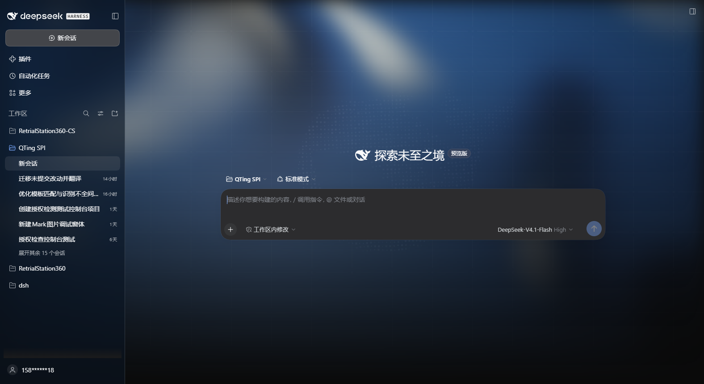

# dsh-homepage-skin

[中文](README.md) · English

A background skin that brings the DeepSeek Harness homepage look — WebGL fluid light, dot-line grid and the digital point-cloud whale — into the `dsh web` interface.




Both themes are covered: dark keeps the deep-blue homepage palette, light gets an adapted variant (light fluid ramp, dark slate grid and whale). Appearance (light / dark / follow system) is still handled by the built-in setting.

## Install

```sh
dsh plugin --profile web add github:yushi-xxh/dsh-homepage-skin
```

Restart `dsh web`, then hard-refresh the browser (Ctrl+Shift+R). Enabled by default.

Open **Settings → General → Homepage Skin**. The green dot next to the title means it is on.

## Verify

| What you see | Meaning |
|---|---|
| Fluid light + dot grid + whale behind the chat | Working |
| Switch appearance to light → light variant appears | Working |
| Toggle the skin off → background disappears instantly | Working |

## What it changes

| | Stock DSH | This skin |
|---|---|---|
| Page background | flat | fluid light + dot grid + digital whale |
| Dark palette | built-in dark | homepage deep-blue (#0a0a0a base) |
| Light palette | built-in light | light fluid ramp with slate grid/whale |
| Sidebar | solid | translucent glass |
| Composer | solid | unchanged (stock) |

Turning the skin off or uninstalling restores the stock look immediately.

## What it does not do

- Change layout or information density
- Change brand colors, favicon or desktop shell icons
- Animate when `prefers-reduced-motion` is on; grid and whale hide below 768px
- headless / TUI has no UI — not needed there

## License

MIT
