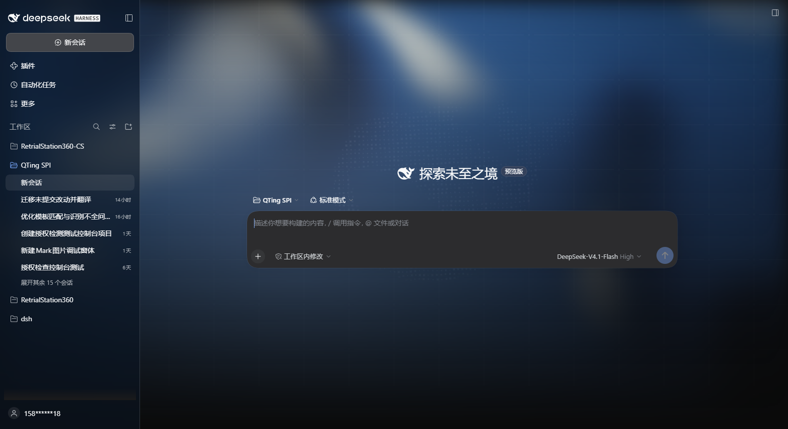

# dsh-dshomepage-skin

给 **DeepSeek Harness 桌面版（0.2.x）** 换上首页同款背景：WebGL 流体光效、点线网格、数字点云鲸鱼，深色 / 亮色两套配色。

本仓库基于 [yushi-xxh/dsh-homepage-skin](https://github.com/yushi-xxh/dsh-homepage-skin)（MIT）适配 DSH 0.2.2-rc.1 的桌面端与 Web 端：视觉与交互沿用原作，重写了外壳选择器与版本声明，使其在当前桌面版里能正确透出背景。

| 深色 | 亮色 |
| --- | --- |
|  |  |

## 兼容性

| 项 | 值 |
| --- | --- |
| 目标运行时 | DSH `>=0.2.2-rc.1 <0.3.0`（`engines.dsh`） |
| 实测版本 | DSH 0.2.2-rc.1（桌面壳 44.7.0，Windows x64） |
| 另一端 | `dsh web` 0.2.x 同样可用 |
| 依赖 | 无：bundle 不 require 任何模块，也不使用 slots / locale / store |

相对于上游 0.1.13 的改动：

- 外壳选择器不再绑定 0.1 的 CSS Module 哈希类名（`.pI_x6G_*`）。0.2.x 改为按稳定的 `data-slot` 契约定位：`[data-slot="root"] > div`（AppFrame）、`[data-slot="sidebar"]`、`[data-slot="main.conversation"]`，旧类名保留为回退，因此 `dsh web` 0.1.x 也能用。
- 补上 0.2.x 桌面端新增的不透明层：Windows 标题栏下 `frame` / `centerCol` 的底色、标题栏拖拽条 `:before`。
- 兼容性声明改用 `engines.dsh`（`>=0.2.2-rc.1 <0.3.0`）；0.2.2 启动时的版本检查因此放行，不再需要 peerDependencies。
- 插件名 / 门控属性改为 `dsh-dshomepage-skin` / `data-dsh-dshomepage-skin`，可与上游插件同时共存。

## 安装

### 桌面版（推荐）

直接从 GitHub 安装（写入 desktop profile 后重启桌面端）：

```sh
dsh plugin --profile desktop add github:SiriusWJ/dsh-dshomepage-skin
```

也可以在「插件」页用 GitHub 地址添加。`dshmarket` 需要先被 awesome-dsh-plugin 收录（仓库需 ≥10 commits 且 ≥1 天），收录后可直接在插件市场搜索。

### dsh web

```sh
dsh plugin --profile web add github:SiriusWJ/dsh-dshomepage-skin
```

## 使用

安装并重启后自动生效，没有设置开关；卸载或禁用插件后所有画布与样式立即移除，恢复出厂外观。

- 深 / 亮配色跟随自带「外观」设置（`body[data-ds-dark-theme]`）。
- `prefers-reduced-motion: reduce` 时保持静态画面，不跑动画。
- 768px 以下窄窗口隐藏鲸鱼与网格，避免遮挡内容。

## 验证

| 现象 | 结论 |
| --- | --- |
| 侧栏、对话区背后出现流体光效 + 点线网格 + 鲸鱼 | 已生效 |
| 外观切到深色 → 深海蓝配色；亮色 → 浅色变体 | 已生效 |
| 安装并重启后自动出现背景，无需任何设置 | 已生效 |
| 卸载或禁用插件后背景立即消失，恢复出厂 | 正常 |

### 验证记录（2026-11-11，DSH 0.2.2-rc.1）

- 临时 profile（`skinlab`，从 shipped web 模板创建）+ 本地 link 安装本包后重启：页面成功挂载 `data-dsh-dshomepage-skin` 门控属性与 3 个画布，`[data-slot="root"] > div` 背景计算值为 `rgba(0,0,0,0)`。
- 本版（0.1.1）去掉了设置开关：bundle 加载即无条件启用，teardown 时移除画布与样式，因此不需要也不提供 `settings.general.item` 槽位注册。
- `npm test`（零依赖 smoke，`test/smoke.cjs`）：bundle id 正确、不 require 任何模块、`inject = []`、样式按门控属性注入、teardown 后样式被移除。
- 深 / 浅两套配色均按 `body[data-ds-dark-theme]` 自动切换，截图见 `docs/compare-dark.png`、`docs/compare-light.png`（1576×860，取自同版本 `dsh web` 页面）。
- 未覆盖项：真实桌面窗口的 Windows 标题栏层未截图复核（选择器按 0.2.2 的 `[data-windows-titlebar]` 规则写入，重启桌面端后需目视确认）。

## 插件显示信息

插件管理与设置页在**不激活插件**的前提下读取显示信息：

- `locale/en.json`、`locale/zh.json` 的 `meta.title` / `meta.description`（标题、说明；缺省回退到包名与 `package.json` 的 description）
- `package.json` 的 `icon`（也可改用 `./icon` 导出）——SVG/PNG/JPEG/WebP，≤256 KiB
- 「支持的 DSH 版本」写在 `engines.dsh`（`>=0.2.2-rc.1 <0.3.0`），说明文字里也直接写明 0.2.2-rc.1+，详情页另有 README

已安装列表里会显示：图标、标题、说明、当前版本。

## 发布

仓库带 tag 触发的 npm 发布 workflow（`.github/workflows/publish.yml`）。推 `v*` tag 前在仓库 Secrets 配好 `NPM_TOKEN`（Granular/Classic publish token，勾选 bypass 2FA），否则 Action 会在 publish 步骤失败。市场收录不是安装前提，`github:SiriusWJ/dsh-dshomepage-skin` 可直接装。

## 目录

```
lib/index.js         宿主半端（no-op loader entry）
lib/client.js        浏览器半端：引擎 + 外壳透明样式
cordis.patch.yml     bundle 补丁层
locale/*.json        插件管理显示的标题 / 说明（meta.title / meta.description）
icon.svg             插件管理显示的图标
package.json         dsh.bundle / dsh.client 清单、icon、engines.dsh
```

## 许可与致谢

MIT。视觉、着色器与鲸鱼点云实现来自 [yushi-xxh/dsh-homepage-skin](https://github.com/yushi-xxh/dsh-homepage-skin)，版权归原作者；本仓库只做 DSH 0.2.x 桌面端适配与维护。
